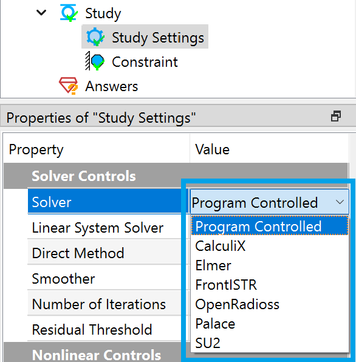

# External solvers

WELSIM is a simulation software that supports multiple solvers and is one of the most comprehensive and widely compatible pre- and post-processing tools for open-source solvers in the world. Currently supported open-source solvers include *FrontISTR*, *Elmer FEM*, *OpenRadioss*, *CalculiX*, *SU2*, *Palace*, *LAMMPS*, *MFEM* and *OpenFOAM*; input for the commercial *Ansys APDL* solver can also be produced. Some solvers are run directly from a WELSIM study, others are supported by exporting a ready-to-run case from the **Tools** menu, as described further down this page. Each of these solvers offers distinct features and advantages, allowing users to choose the one that best suits their needs. Thanks to WELSIM’s powerful pre- and post-processing capabilities, the time required for modeling when using these solvers is significantly reduced.

This section primarily introduces the details and usage methods of external solvers.

## Configuration
When invoking external solvers, a simple configuration of the solver paths is required. Users only need to go to the *Preferences* interface, select *Solvers*, and configure the solvers accordingly. The configuration interface is shown below.

Details of each supported solver are provided in the table below. This table includes solver information, integration and calling methods with WELSIM, support status for preprocessing and postprocessing, and whether they are included in WELSIM's installer.

| Solver | Download Site | Connection Type | Pre-processing | Post-processing | Included in the installer | 
| --- | --- | --- | --- | --- | --- |
| Elmer FEM | https://elmerfem.org | Path | Yes | Yes | No |
| OpenRadioss(OpenCourant) | https://opencourant.org | Path | Yes | Yes | No|
| FrontISTR | https://frontistr.com | File | Yes | Yes | Yes |
| CalculiX | https://calculix.de | File | Yes | Yes | No |
| Palace | https://awslabs.github.io/palace | File | Yes | Yes | Yes |
| SU2 | https://su2code.github.io | File | Yes | Yes | Yes |
| LAMMPS | https://lammps.org | File | Yes | Yes | No |

Due to restrictions of the GNU open-source license, *Elmer FEM*, *OpenRadioss*, *CalculiX*, and *LAMMPS* are not included in WELSIM's installer and require users to download them independently. You can configure these solvers through the Preferences in WELSIM.

*CalculiX* results are read from the `.frd` file of the run, and *Elmer FEM* results from the `elmer_welsim.result` (or `elmer_welsim.rst`) file written next to the case; both appear in the WELSIM result tree like any other study.

## Script export

Some solvers are supported by export rather than by a study solver entry: the case is written from the **Tools** menu and is then started by the user, on their own machine or on [WELSIM Cloud <i class="fa fa-external-link"></i>](https://cloud.welsim.com). Each command writes into the study folder (`<project folder>\<study name>`) and rewrites the whole set of files on every run, so files that you edit by hand should be saved as copies.

| Menu command | Solver | Files written |
| --- | --- | --- |
| Export CalculiX script | CalculiX | `calculix_welsim.inp` |
| Export Elmer script | Elmer FEM | `elmer_welsim.sif` plus the Elmer mesh in the case folder |
| Export FrontISTR script | FrontISTR | `fstr_welsim.cnt` and `fstr_welsim.avs` |
| Export Ansys APDL script | Ansys Mechanical APDL | `apdl_welsim.dat` (input deck) and `apdlmesh_welsim.dat` (nodes, elements, materials) |
| Export OpenRadioss script | OpenRadioss | `radioss_welsim_0000.rad`, `radioss_welsim_0001.rad` and the mesh include `radioss_welsim.inc` |
| Export SU2 script | SU2 | `su2_welsim.cfg` and `mesh_welsim.su2` |
| Export OpenFOAM script | OpenFOAM | the case folder `welsim_openfoam_case`, with the mesh in `constant/polyMesh` (blockMesh, boundary surfaces and sets) |
| Export MFEM script | MFEM | `mfem_welsim.mmesh` |
| Export Palace script | Palace | `palace_welsim.json` |
| Export LAMMPS script | LAMMPS | `lammps_welsim.in` |

The Ansys APDL export maps the WELSIM model onto APDL as follows:

* Element types follow the order and dimension of the WELSIM mesh: 3-D solid SOLID185/SOLID186, shell SHELL181/SHELL281, spar and pipe LINK180/PIPE188, and so on.
* Element real constants, such as shell thickness, and section data are written with the mesh.
* Material tables cover the linear elastic, hyperelastic (Mooney-Rivlin, Neo-Hookean, Ogden, Blatz-Kreiss, …), plasticity and creep laws of the WELSIM material object.
* Loads follow the WELSIM solver mapping: concentrated forces, pressures and accelerations are exported as component loads on nodes and elements, and a prescribed rotation is converted into equivalent displacements applied on a reference node coupled to the constrained nodes.

## Default solver
For different types of simulation analyses, WELSIM automatically sets a default solver. However, users can also manually specify the solver to be used. As shown in the figure below,

When the user selects *Program Controlled*, the system automatically assigns a solver based on the following logic:

1. If the analysis type is structural and explicit transient is not enabled, the system automatically uses the **FrontISTR** solver.
2. If the analysis type is explicit structural dynamics, the system automatically uses the **OpenRadioss** solver.
3. If the analysis type is thermal, the system automatically uses the **FrontISTR** solver.
4. For fluid analysis types, the system automatically uses the **SU2** solver.
5. For electromagnetic analysis types, the system automatically uses the **Palace** solver.
6. When the project type is molecular dynamics, the system automatically uses the **LAMMPS** solver.

---
<small>
WelSim is not directly affiliated with Elmer FEM, FrontISTR, OpenRadioss, CalculiX, Palace，SU2, LAMMPS, MFEM, OpenFOAM, and Ansys APDL. References to these solvers are solely for technical blog purposes and software usage guidance.
</small>