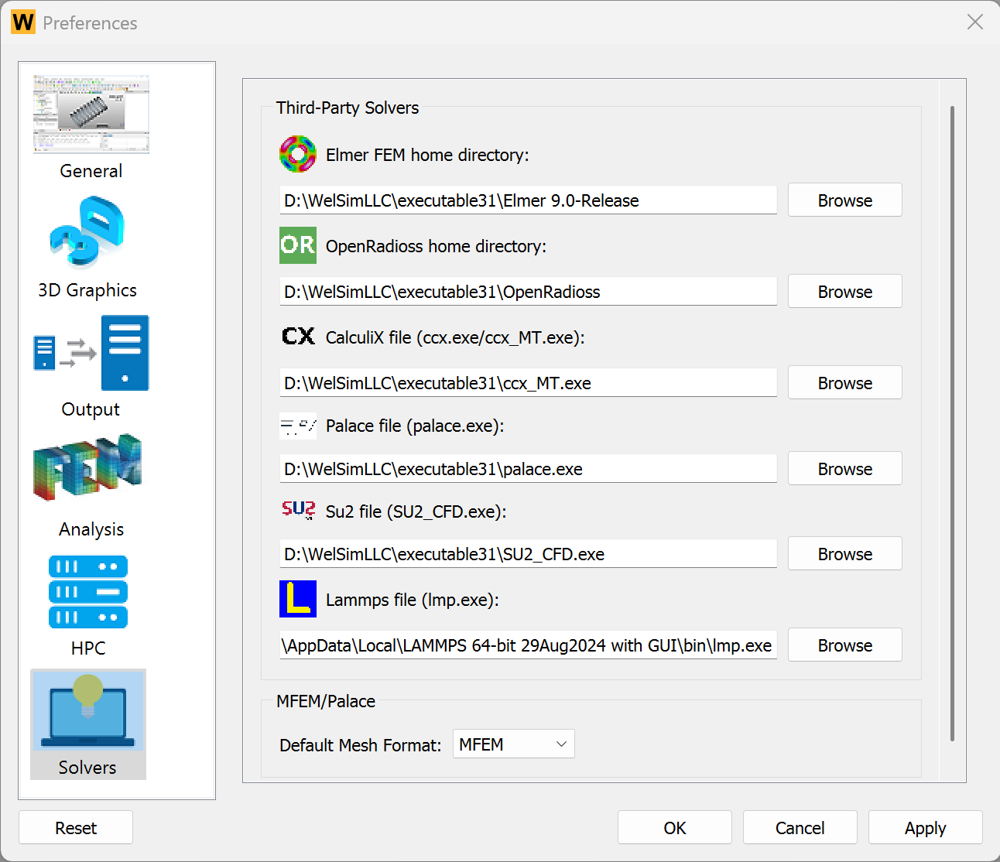

# External solvers

WELSIM is a simulation software that supports multiple solvers and is one of the most comprehensive and widely compatible pre- and post-processing tools for open-source solvers in the world. Currently supported open-source solvers include *FrontISTR*, *Elmer FEM*, *OpenRadioss*, *CalculiX*, *SU2*, *Palace*, *LAMMPS*, *MFEM* and *OpenFOAM*; Some solvers are run directly from a WELSIM study, others are supported by exporting a ready-to-run case from the **Tools** menu, as described further down this page. Each of these solvers offers distinct features and advantages, allowing users to choose the one that best suits their needs. Thanks to WELSIM’s powerful pre- and post-processing capabilities, the time required for modeling when using these solvers is significantly reduced.

This section primarily introduces the details and usage methods of external solvers.

## Configuration
When invoking external solvers, a simple configuration of the solver paths is required. Users only need to go to the *Preferences* interface, select *Solvers*, and configure the solvers accordingly. The configuration interface is shown below.

Details of each supported solver are provided in the table below. This table includes solver information, integration and calling methods with WELSIM, support status for preprocessing and postprocessing, and whether they are included in WELSIM's installer.

| Solver | Download Site | Connection Type | Pre-processing | Post-processing | Included in the installer | 
| --- | --- | --- | --- | --- | --- |
| Elmer FEM | https://elmerfem.org | Path | Yes | Yes | No |
| OpenRadioss(OpenCourant) | https://opencourant.org | Path | Yes | Yes | No|
| FrontISTR | https://frontistr.com | File | Yes | Yes | Yes |
| CalculiX | https://calculix.de | File | Yes | Yes | No |
| Palace | https://awslabs.github.io/palace | File | Yes | Yes | Yes |
| SU2 | https://su2code.github.io | File | Yes | Yes | Yes |
| LAMMPS | https://lammps.org | File | Yes | Yes | No |

Due to restrictions of the GNU open-source license, *Elmer FEM*, *OpenRadioss*, *CalculiX*, and *LAMMPS* are not included in WELSIM's installer and require users to download them independently. You can configure these solvers through the Preferences in WELSIM. Alternatively, **Tools -> Install third-party software...** downloads and configures supported helper applications (external post-processing tools and some solvers) from within WELSIM automatically.

*CalculiX* results are read from the `.frd` file of the run, and *Elmer FEM* results from the `elmer_welsim.result` (or `elmer_welsim.rst`) file written next to the case; both appear in the WELSIM result tree like any other study.

## Elmer FEM

*Elmer FEM* is a general multiphysics solver. WELSIM writes the case as the deck `elmer_welsim.sif` with the Elmer mesh next to it, starts `ElmerSolver` when the study is solved, and reads the results back, so an Elmer analysis follows the same workflow as a built-in study. Elmer is not redistributed with WELSIM because of its GNU license: install it from [elmerfem.org](https://elmerfem.org) and give WELSIM the installation folder in the preferences, like the other path-connected solvers. WELSIM then sets the runtime environment (`ELMER_HOME`, `ELMER_LIB`, `PATH`) for the run on its own.

### Analysis types

Select *Elmer FEM* in **Study Settings** and pick an equation from the Elmer equation list; more equations can be added to the same study with the **Additional Solver** object, which offers the same list.

| Field | Equations |
| --- | --- |
| Heat transfer | Heat Equation, Poisson BEM |
| Structure | Stress Analysis |
| Electric | Static Electrical Solver, Static Current Solver, Coil Solver |
| Magneto-dynamics | MagnetoDynamics (subtypes: Whitney AV Solver, Whitney AV Harmonic Solver, MagnetoDynamics Calculated Fields), Vector Helmholtz, Fourier Loss, Circuits And Dynamics |
| Flow helpers | Stream Solver, Fluidic Force, Free Surface Reduced |
| Data equations | Save Scalars, Save Line, Mesh Update |

For the magneto-dynamics equations the model is built in terms of the magnetic vector potential **AV**. WELSIM writes:

* Boundary conditions: *EM Ground*, *Voltage*, and *Magnetic Potential* — on magneto-dynamics boundaries the prescribed value is applied to the vector potential components.
* Body loads: *Magnetization* and *Current Density* as Elmer body forces on the target bodies.
* Elements: the magneto-dynamics equations use Elmer's Whitney edge elements through the solver subtypes above.

### Materials

The following WELSIM material properties are written into the Elmer deck: Density, Mass, Constant Damping Coefficient, Isotropic Thermal Expansion (also the instantaneous variant), Local Coordinates, Isotropic Elasticity, Dynamic Viscosity, Enthalpy, Isotropic Thermal Conductivity, Specific Heat, Isotropic Electrical Conductivity (`Electric Conductivity`), Isotropic Relative Permittivity, and Relative Permeability. Relative permeability can be isotropic (a single value) or orthotropic, which is written as the three diagonal components `Relative Permeability(3) = x y z`.

### Results

After the run WELSIM imports `elmer_welsim.result` (or `elmer_welsim.rst`) into the result tree: nodal quantities such as temperature, displacement, stress, strain, velocity and pressure display like any other study. Quantities saved by a **Save Scalars** equation (`scalars.dat` with its `scalars.dat.names` sidecar) are imported as curves of time or iteration.

## Script export

Some solvers are supported by export rather than by a study solver entry: the case is written from the **Tools** menu and is then started by the user, on their own machine or on [WELSIM Cloud <i class="fa fa-external-link"></i>](https://cloud.welsim.com). Each command writes into the study folder (`<project folder>\<study name>`) and rewrites the whole set of files on every run, so files that you edit by hand should be saved as copies.

| Menu command | Solver | Files written |
| --- | --- | --- |
| Export CalculiX script | CalculiX | `calculix_welsim.inp` |
| Export Elmer script | Elmer FEM | `elmer_welsim.sif` plus the Elmer mesh in the case folder |
| Export FrontISTR script | FrontISTR | `fstr_welsim.cnt` and `fstr_welsim.avs` |
| Export OpenRadioss script | OpenRadioss | `radioss_welsim_0000.rad`, `radioss_welsim_0001.rad` and the mesh include `radioss_welsim.inc` |
| Export SU2 script | SU2 | `su2_welsim.cfg` and `mesh_welsim.su2` |
| Export OpenFOAM script | OpenFOAM | the case folder `welsim_openfoam_case`, with the mesh in `constant/polyMesh` (blockMesh, boundary surfaces and sets) |
| Export MFEM script | MFEM | `mfem_welsim.mmesh` |
| Export Palace script | Palace | `palace_welsim.json` |
| Export LAMMPS script | LAMMPS | `lammps_welsim.in` |

## Default solver
For different types of simulation analyses, WELSIM automatically sets a default solver. However, users can also manually specify the solver to be used. As shown in the figure below,

When the user selects *Program Controlled*, the system automatically assigns a solver based on the following logic:

1. If the analysis type is structural and explicit transient is not enabled, the system automatically uses the **FrontISTR** solver.
2. If the analysis type is explicit structural dynamics, the system automatically uses the **OpenRadioss** solver.
3. If the analysis type is thermal, the system automatically uses the **FrontISTR** solver.
4. For fluid analysis types, the system automatically uses the **SU2** solver.
5. For electromagnetic analysis types, the system automatically uses the **Palace** solver.
6. When the project type is molecular dynamics, the system automatically uses the **LAMMPS** solver.

---
<small>
WelSim is not directly affiliated with Elmer FEM, FrontISTR, OpenRadioss, CalculiX, Palace，SU2, LAMMPS, MFEM, OpenFOAM, and Ansys APDL. References to these solvers are solely for technical blog purposes and software usage guidance.
</small>